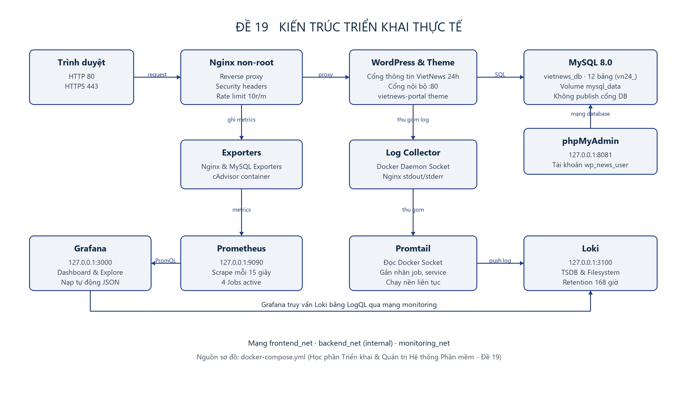

<div align="center">

| TRƯỜNG ĐẠI HỌC CNTT VÀ TRUYỀN THÔNG <br/> KHOA CÔNG NGHỆ THÔNG TIN |
| :---: |
| **BÁO CÁO** <br/> **HỌC PHẦN TRIỂN KHAI & QUẢN TRỊ HỆ THỐNG PHẦN MỀM** |
| <br/> **Đề tài:** <br/> **Website Tin tức / Cổng thông tin (Đề 19)** <br/> *(Hệ thống Cổng thông tin điện tử VietNews 24h)* <br/> |
| **Sinh viên thực hiện:** Đào Tùng Anh |
| **Mã sinh viên:** DTC245220035 |
| **Lớp:** An Toàn Thông Tin (ATTT K23A) |
| **Giảng viên hướng dẫn:** Nguyễn Anh Chuyên |
| <br/> **THÁI NGUYÊN, NĂM 2026** |

</div>

<div style="page-break-after: always;"></div>

---

# LỜI NÓI ĐẦU

Báo cáo trình bày kết quả triển khai **Đề 19: Website Tin tức / Cổng thông tin** của sinh viên **Đào Tùng Anh**. Hệ thống cung cấp cổng thông tin điện tử tiếng Việt **VietNews 24h** phục vụ độc giả với các bài viết nổi bật, bài viết mới nhất phân theo chuyên mục và công cụ tìm kiếm, đồng thời tích hợp phân hệ quản trị nội dung WordPress (WP-Admin) với dữ liệu được lưu trữ bền vững trong cơ sở dữ liệu MySQL 8.0. Toàn bộ các dịch vụ được đóng gói và vận hành đồng bộ bằng Docker Compose, tiếp nhận truy cập qua Nginx reverse proxy bảo mật, giám sát hiệu năng với Prometheus + Grafana và thu thập nhật ký tập trung qua Loki + Promtail.

Trọng tâm của bài thực hành là chứng minh ứng dụng hoạt động ổn định song hành cùng hạ tầng quản trị vận hành. Vì vậy, bên cạnh mã nguồn giao diện và cấu hình dịch vụ, báo cáo đưa vào chi tiết các kết quả truy vấn metrics thời gian thực, các truy vấn LogQL kiểm chứng nhật ký và các phép kiểm thử an toàn thông tin (System Hardening). Toàn bộ dữ liệu kiểm chứng được thu thập trực tiếp trong tháng 10 năm 2026 trên môi trường Docker Desktop chạy Linux containers.

Qua quá trình triển khai, ứng dụng kết nối thành công tới MySQL 8.0; trang quản trị WP-Admin thực hiện trơn tru các thao tác đăng, sửa, xóa bài viết và quản lý danh mục; Nginx phục vụ kết nối HTTPS mã hóa bằng chứng chỉ tự ký kèm đầy đủ Security Headers; Prometheus thu thập dữ liệu liên tục từ các exporter; Grafana hiển thị dashboard giám sát trực quan và Loki truy vấn chính xác nhật ký của Nginx, WordPress và Database. Các biện pháp hardening, phân quyền tối thiểu và bảo toàn dữ liệu bằng volume đều được kiểm chứng độc lập bằng câu lệnh thực tế.

Em xin chân thành cảm ơn thầy **Nguyễn Anh Chuyên** đã tận tình hướng dẫn học phần *Triển khai và Quản trị Hệ thống Phần mềm*. Thông qua đề tài, em đã có cơ hội hệ thống hóa toàn diện quy trình từ đóng gói dịch vụ, thiết kế mạng cô lập, cấu hình reverse proxy, thiết lập hệ thống quan sát (Observability) đến kiểm thử bảo mật và trình bày minh chứng. Những giới hạn còn tồn tại trong phạm vi máy tính cá nhân được nêu rõ trong phần kết luận để định hướng hoàn thiện trong môi trường sản xuất thực tế.

**Sinh viên thực hiện**  
*Đào Tùng Anh*

<div style="page-break-after: always;"></div>

---

# MỤC LỤC

- [PHẦN 1 GIỚI THIỆU TỔNG QUAN HỆ THỐNG](#phần-1-giới-thiệu-tổng-quan-hệ-thống)
  - [1.1 Mục tiêu và phạm vi đề tài](#11-mục-tiêu-và-phạm-vi-đề-tài)
  - [1.2 Môi trường thực nghiệm](#12-môi-trường-thực-nghiệm)
  - [1.3 Kiến trúc và luồng hoạt động](#13-kiến-trúc-và-luồng-hoạt-động)
  - [1.4 Các dịch vụ mạng và dữ liệu lưu trữ](#14-các-dịch-vụ-mạng-và-dữ-liệu-lưu-trữ)
- [PHẦN 2 QUẢN LÝ MÃ NGUỒN VÀ TRIỂN KHAI](#phần-2-quản-lý-mã-nguồn-và-triển-khai)
  - [2.1 Repository và cấu trúc mã nguồn](#21-repository-và-cấu-trúc-mã-nguồn)
  - [2.2 Ba commit mốc và quy trình quản lý thay đổi](#22-ba-commit-mốc-và-quy-trình-quản-lý-thay-đổi)
  - [2.3 Đóng gói và khởi chạy bằng Docker Compose](#23-đóng-gói-và-khởi-chạy-bằng-docker-compose)
  - [2.4 Cơ sở dữ liệu của ứng dụng](#24-cơ-sở-dữ-liệu-của-ứng-dụng)
  - [2.5 Giao diện tin tức và cổng thông tin VietNews 24h](#25-giao-diện-tin-tức-và-cổng-thông-tin-vietnews-24h)
  - [2.6 Đăng nhập và quản trị nội dung WordPress](#26-đăng-nhập-và-quản-trị-nội-dung-wordpress)
  - [2.7 Kiểm tra MySQL bằng phpMyAdmin](#27-kiểm-tra-mysql-bằng-phpmyadmin)
- [PHẦN 3 NGINX VÀ HARDENING HỆ THỐNG](#phần-3-nginx-và-hardening-hệ-thống)
  - [3.1 Reverse proxy và security headers](#31-reverse-proxy-và-security-headers)
  - [3.2 HTTPS tự ký và bảo mật truyền thông](#32-https-tự-ký-và-bảo-mật-truyền-thông)
  - [3.3 Bảo vệ tài khoản và dữ liệu ứng dụng](#33-bảo-vệ-tài-khoản-và-dữ-liệu-ứng-dụng)
  - [3.4 Hardening container, mạng và cơ sở dữ liệu](#34-hardening-container-mạng-và-cơ-sở-dữ-liệu)
- [PHẦN 4 GIÁM SÁT VÀ LOG TẬP TRUNG](#phần-4-giám-sát-và-log-tập-trung)
  - [4.1 Cấu hình Prometheus và các exporter](#41-cấu-hình-prometheus-và-các-exporter)
  - [4.2 Dashboard Grafana và dữ liệu container](#42-dashboard-grafana-và-dữ-liệu-container)
  - [4.3 Giám sát Nginx, MySQL và kiểm tra tạo tải](#43-giám-sát-nginx-mysql-và-kiểm-tra-tạo-tải)
  - [4.4 Thiết kế hệ thống log tập trung](#44-thiết-kế-hệ-thống-log-tập-trung)
  - [4.5 Phương pháp kiểm chứng log](#45-phương-pháp-kiểm-chứng-log)
  - [4.6 LogQL xem log truy cập Nginx](#46-logql-xem-log-truy-cập-nginx)
  - [4.7 LogQL lọc request lỗi HTTP và bảo mật](#47-logql-lọc-request-lỗi-http-và-bảo-mật)
  - [4.8 LogQL theo dõi thao tác WordPress Admin](#48-logql-theo-dõi-thao-tác-wordpress-admin)
- [PHẦN 5 KIỂM THỬ VẬN HÀNH VÀ ĐỐI CHIẾU](#phần-5-kiểm-thử-vận-hành-và-đối-chiếu)
  - [5.1 Kết quả kiểm thử chức năng và tích hợp](#51-kết-quả-kiểm-thử-chức-năng-và-tích-hợp)
  - [5.2 Khả năng bảo toàn dữ liệu bằng Volume](#52-khả-năng-bảo-toàn-dữ-liệu-bằng-volume)
  - [5.3 Các lỗi gặp và cách xử lý](#53-các-lỗi-gặp-và-cách-xử-lý)
  - [5.4 Đối chiếu yêu cầu và kịch bản demo](#54-đối-chiếu-yêu-cầu-và-kịch-bản-demo)
- [KẾT LUẬN VÀ HƯỚNG PHÁT TRIỂN](#kết-luận-và-hướng-phát-triển)
- [TÀI LIỆU THAM KHẢO](#tài-liệu-tham-khảo)

<div style="page-break-after: always;"></div>

---

# PHẦN 1 GIỚI THIỆU TỔNG QUAN HỆ THỐNG

## 1.1 Mục tiêu và phạm vi đề tài

Cổng thông tin điện tử và website tin tức là nền tảng truyền tải thông tin đòi hỏi tần suất cập nhật cao, khả năng phân loại danh mục khoa học và giao diện đọc thân thiện với người dùng. Khi quy mô nội dung mở rộng, một hệ thống quản trị nội dung (CMS) mạnh mẽ giúp đội ngũ biên tập viên xuất bản bài viết mà không can thiệp vào mã nguồn giao diện. Đề tài xây dựng cổng thông tin điện tử **VietNews 24h** đáp ứng luồng đọc tin tức công khai và phân hệ quản trị bảo vệ bằng phiên đăng nhập, sau đó triển khai toàn diện cùng hệ sinh thái quản trị cơ sở dữ liệu, reverse proxy, giám sát và lưu trữ nhật ký tập trung.

Mục tiêu kỹ thuật bao gồm: quản lý toàn bộ mã nguồn và cấu hình trên GitHub; đóng gói ứng dụng WordPress, cơ sở dữ liệu MySQL và công cụ phpMyAdmin bằng Docker Compose; tiếp nhận mọi kết nối thông qua Nginx reverse proxy hỗ trợ HTTPS tự ký và Security Headers; giám sát container, web server và database bằng Prometheus và Grafana; thu gom log tập trung bằng Loki và Promtail; áp dụng đa tầng các biện pháp gia cố an toàn thông tin (System Hardening). Tất cả kết quả triển khai đều được chứng minh bằng câu lệnh thực tế, giao diện vận hành và kịch bản kiểm thử tự động.

Ứng dụng tin tức sử dụng **WordPress Official Docker Image (`wordpress:6.7-php8.2-apache`)** kết hợp giao diện báo điện tử tiếng Việt chuyên biệt **`vietnews-portal`**, cơ sở dữ liệu **MySQL 8.0** và công cụ quản trị **phpMyAdmin 5.2**. Phạm vi demo gồm hai tài khoản phân quyền quản trị (Admin và Editor), 6 chuyên mục tin tức chuẩn thời sự, 10 bài viết mẫu tiếng Việt ban đầu và cơ chế sinh ảnh bìa SVG tự động theo màu chuyên mục.

| Yêu cầu đề bài (Đề 19) | Cách đáp ứng trong hệ thống |
| :--- | :--- |
| **Quản lý mã nguồn GitHub** | Repository tổ chức chặt chẽ, tài liệu README chi tiết, đủ 03 commit mốc có ý nghĩa kỹ thuật rõ ràng. |
| **Ứng dụng và Cơ sở dữ liệu** | Cổng thông tin VietNews 24h tiếng Việt, phân hệ WP-Admin CRUD bài viết, MySQL 8.0 và phpMyAdmin. |
| **Reverse Proxy** | Nginx HTTP cổng 80 (tự động chuyển hướng 301 sang HTTPS) và HTTPS cổng 443 với chứng chỉ tự ký RSA 2048-bit. |
| **Hệ thống giám sát** | Prometheus scrape metrics mỗi 15 giây từ cAdvisor (container), Nginx Exporter (web) và MySQL Exporter (DB); Grafana dashboard hiển thị trực quan. |
| **Logging tập trung** | Promtail thu thập log container và Nginx, Loki lưu trữ TSDB filesystem, thực thi tối thiểu 3 truy vấn LogQL thực tế. |
| **Gia cố bảo mật (Hardening)** | Chạy Non-root UID, cô lập 3 mạng Docker, giới hạn quyền Linux Capabilities (`cap_drop: ALL`, `no-new-privileges`), tước quyền DB và gắn Security Headers. |

## 1.2 Môi trường thực nghiệm

Hệ thống được triển khai và kiểm thử trên máy tính cá nhân chạy hệ điều hành Windows với Docker Desktop, context `desktop-linux` (nền tảng WSL2). Phiên bản Docker Engine là 29.7.2, Docker Compose v5.4.0 và Git 2.55.0.

Trong quá trình khởi chạy, các xung đột cổng cục bộ được giải quyết bằng việc ánh xạ cổng dịch vụ rõ ràng: Nginx đón cổng 80 và 443; phpMyAdmin bind cục bộ `127.0.0.1:8081`; Grafana bind `127.0.0.1:3000`; Prometheus bind `127.0.0.1:9090`; cAdvisor bind `127.0.0.1:8082`; Loki bind `127.0.0.1:3100`. Các cổng nội bộ nhạy cảm gồm MySQL (cổng 3306), WordPress Apache (cổng 80) và các Exporters (9104, 9113) hoàn toàn không được công bố (publish) ra máy host, bảo đảm tính khép kín của mạng nội bộ.

## 1.3 Kiến trúc và luồng hoạt động



*Hình 1.1 Kiến trúc hệ thống theo các file Docker Compose*

Luồng hoạt động của hệ thống được chia làm 3 luồng dữ liệu độc lập:
1. **Luồng phục vụ người dùng (HTTP/HTTPS):** Độc giả và quản trị viên gửi yêu cầu tới Nginx. Yêu cầu cổng 80 được chuyển hướng 301 sang HTTPS 443. Nginx kiểm tra các bộ lọc bảo mật, rate limit và gắn các Security Headers, sau đó chuyển tiếp request qua mạng `frontend_net` tới `vietnews-wordpress:80`. WordPress truy vấn dữ liệu từ `vietnews-mysql:3306` qua mạng kín `backend_net` và trả về mã HTML hoàn chỉnh cho trình duyệt.
2. **Luồng thu thập chỉ số giám sát (Metrics):** Tách biệt hoàn toàn khỏi luồng người dùng trên mạng `monitoring_net`. Prometheus kéo (pull) chỉ số chu kỳ 15 giây từ Google cAdvisor (CPU, RAM container), Nginx Exporter (kết nối và request qua `/nginx_status`) và MySQL Exporter (QPS, threads, uptime qua tài khoản `exporter_user`). Grafana truy vấn Prometheus bằng PromQL để kết xuất biểu đồ.
3. **Luồng thu gom nhật ký (Logging):** Promtail kết nối tới Docker Socket (`/var/run/docker.sock`), tự động nhận diện các container và luồng log stdout/stderr, gắn nhãn định danh (`service`, `container`, `job`) rồi đẩy về Loki qua cổng nội bộ 3100. Người quản trị sử dụng giao diện Grafana Explore để truy vấn log bằng LogQL.

## 1.4 Các dịch vụ mạng và dữ liệu lưu trữ

Hệ thống bao gồm 12 dịch vụ container được định nghĩa chặt chẽ:

| Tên dịch vụ | Image Docker | Cổng Host | Vai trò chính |
| :--- | :--- | :--- | :--- |
| **`nginx`** | `nginx:1.27-alpine` | `80`, `443` | Reverse proxy, xử lý TLS tự ký, gắn Security Headers, rate limiting. |
| **`wordpress`** | `wordpress:6.7-php8.2-apache` | *Không publish* | Cổng thông tin VietNews 24h, hiển thị và quản lý bài báo. |
| **`wp-setup`** | `wordpress:cli-2.11-php8.2` | *Không publish* | One-shot init container tự động cài đặt theme và nạp 10 bài báo mẫu. |
| **`mysql`** | `mysql:8.0` | *Không publish* | Hệ quản trị cơ sở dữ liệu quan hệ lưu trữ dữ liệu website. |
| **`phpmyadmin`** | `phpmyadmin:5.2-apache` | `127.0.0.1:8081` | Giao diện web quản trị cơ sở dữ liệu MySQL cục bộ. |
| **`cadvisor`** | `gcr.io/cadvisor/cadvisor:v0.49.1` | `127.0.0.1:8082` | Thu thập chỉ số tài nguyên phần cứng của toàn bộ containers. |
| **`nginx-exporter`**| `nginx/nginx-prometheus-exporter:1.3.0`| *Không publish* | Thu thập metrics từ endpoint nội bộ `/nginx_status` của Nginx. |
| **`mysql-exporter`**| `prom/mysqld-exporter:v0.15.1` | *Không publish* | Thu thập chỉ số MySQL bằng tài khoản quyền tối thiểu `exporter_user`. |
| **`prometheus`** | `prom/prometheus:v2.53.1` | `127.0.0.1:9090` | Thu thập và lưu trữ cơ sở dữ liệu chuỗi thời gian (TSDB). |
| **`grafana`** | `grafana/grafana:11.1.0` | `127.0.0.1:3000` | Trực quan hóa dữ liệu giám sát và giao diện truy vấn LogQL. |
| **`loki`** | `grafana/loki:2.9.8` | `127.0.0.1:3100` | Lưu trữ và lập chỉ mục nhật ký tập trung theo nhãn. |
| **`promtail`** | `grafana/promtail:2.9.8` | *Không publish* | Tác nhân tự động thu gom log từ Docker Socket đẩy về Loki. |

Hệ thống thiết lập **03 mạng cầu nối (Bridge Networks)**:
- `frontend_net`: Nối `nginx` và `wordpress`.
- `backend_net`: Nối `mysql`, `wordpress`, `wp-setup`, `phpmyadmin` và `mysql-exporter`. MySQL không tham gia `frontend_net` nên Nginx hoàn toàn không thể tiếp cận cổng 3306.
- `monitoring_net`: Nối `prometheus`, `grafana`, `loki`, `promtail`, `cadvisor`, `nginx-exporter`, `mysql-exporter` và `nginx`.

Dữ liệu được lưu trữ trên **06 Docker Named Volumes**: `mysql_data` (bảo toàn bảng cơ sở dữ liệu), `wordpress_data` (mã nguồn và tệp tải lên), `nginx_logs` (nhật ký Nginx), `prometheus_data` (TSDB metrics), `grafana_data` (cấu hình dashboard) và `loki_data` (chỉ mục và khối log).

<div style="page-break-after: always;"></div>

---

# PHẦN 2 QUẢN LÝ MÃ NGUỒN VÀ TRIỂN KHAI

## 2.1 Repository và cấu trúc mã nguồn

Toàn bộ mã nguồn, tệp cấu hình và tài liệu hướng dẫn được quản lý tại Git repository với tài khoản đặt theo mã số sinh viên: **DTC245220035**.

Cấu trúc cây thư mục dự án được tổ chức khoa học:
```text
.
├── .env                                # Biến môi trường và mật khẩu phức tạp
├── .env.example                        # Mẫu biến môi trường phục vụ triển khai
├── .gitattributes                      # Chuẩn hóa ký tự xuống dòng LF cho container
├── .gitignore                          # Loại trừ dữ liệu tạm và file nhạy cảm
├── docker-compose.yml                  # Khởi chạy toàn bộ 12 dịch vụ, 3 mạng, 6 volumes
├── README.md                           # Hướng dẫn chi tiết cách chạy và kịch bản demo
├── BAO_CAO_DO_AN_DE_19.md              # Báo cáo đồ án đầy đủ định dạng Markdown
├── BAO_CAO_DO_AN_DE_19.docx            # Báo cáo đồ án chuẩn Microsoft Word
├── mysql/
│   ├── conf.d/hardening.cnf            # Cấu hình bảo mật và utf8mb4 cho MySQL 8.0
│   ├── init/01-init-security.sql       # Phân quyền tối thiểu cho exporter và web user
│   └── exporter.cnf                    # Cấu hình tài khoản chỉ đọc cho mysqld-exporter
├── nginx/
│   ├── nginx.conf                      # Cấu hình lõi Nginx, rate limit và server_tokens off
│   ├── conf.d/default.conf             # Reverse proxy, Security Headers, HTTPS, chặn file cấm
│   └── certs/                          # Chứng chỉ số tự ký (server.crt, server.key)
├── wordpress/
│   ├── setup/init-wordpress.sh         # Script tự động hóa cài đặt và tạo 10 bài báo mẫu
│   └── themes/vietnews-portal/         # Giao diện Cổng thông tin VietNews 24h tiếng Việt
│       ├── style.css                   # Thiết kế responsive chuẩn báo điện tử
│       ├── functions.php               # Đếm lượt xem, tính thời gian đọc, ảnh SVG động
│       ├── header.php                  # Tin nóng 24h, logo, tìm kiếm, navigation chuyên mục
│       ├── index.php                   # Trang chủ: Bài viết nổi bật & Bài viết mới nhất
│       ├── single.php                  # Trang đọc bài báo chi tiết, bài viết cùng chuyên mục
│       ├── category.php                # Trang danh sách bài viết theo từng chuyên mục
│       ├── search.php                  # Trang hiển thị kết quả tìm kiếm bài viết
│       ├── sidebar.php                 # Tìm kiếm, danh mục, top đọc nhiều, thông tin hạ tầng
│       └── footer.php                  # Chân trang cổng thông tin
├── prometheus/
│   └── prometheus.yml                  # Cấu hình thu thập 4 scrape jobs
├── grafana/
│   └── provisioning/
│       ├── datasources/datasources.yml # Tự động nạp Prometheus và Loki làm nguồn dữ liệu
│       └── dashboards/
│           ├── dashboards.yml          # Tự động nạp dashboard khi khởi động
│           └── json/vietnews-monitoring.json # Dashboard giám sát toàn diện Đề 19
├── loki/
│   ├── loki-config.yml                 # Cấu hình lưu trữ và phân vùng log Loki
│   └── logql-queries.md                # 6 câu truy vấn LogQL thực tế
├── promtail/
│   └── promtail-config.yml             # Cấu hình thu gom log từ Docker Socket
└── scripts/
    └── verify-system.ps1               # Script kiểm thử tự động toàn diện hệ thống
```

## 2.2 Ba commit mốc và quy trình quản lý thay đổi

Lịch sử Git được chia thành **03 commit mốc** rõ ràng, phản ánh đúng từng giai đoạn phát triển theo quy định của đề bài:

| Mốc | Hash Commit | Nội dung kỹ thuật chính |
| :--- | :--- | :--- |
| **Commit 1** | `2d61629` | Triển khai website WordPress với theme VietNews 24h, MySQL 8.0, phpMyAdmin và Nginx HTTPS reverse proxy tích hợp security headers. |
| **Commit 2** | `5b3b53c` | Tích hợp hệ thống giám sát Prometheus + Grafana cùng các exporters cho container (cAdvisor), web server (Nginx) và database (MySQL); tự động nạp Dashboard. |
| **Commit 3** | `93dc43d` | Tích hợp hệ thống log tập trung Loki + Promtail, tài liệu truy vấn LogQL, hoàn thiện các lớp hardening, script kiểm thử tự động và báo cáo đồ án. |

Lệnh kiểm tra lịch sử commit trong repository:
```bash
git log --oneline --reverse
```

## 2.3 Đóng gói và khởi chạy bằng Docker Compose

Toàn bộ dịch vụ được khởi chạy tự động thông qua Docker Compose. Thứ tự sẵn sàng của các dịch vụ được điều phối bằng cơ chế `healthcheck` kết hợp `depends_on`:
- Container `mysql` thực hiện kiểm tra `mysqladmin ping`.
- Container `wordpress` chỉ khởi động sau khi MySQL chuyển sang trạng thái `healthy`.
- Container `wp-setup` đợi MySQL sẵn sàng và mã nguồn WordPress giải nén đầy đủ mới tiến hành cấu hình và tự động thoát khi xong việc.
- Container `nginx` chờ WordPress sẵn sàng mới mở cổng đón người dùng.

Khởi chạy toàn bộ hệ thống bằng câu lệnh duy nhất:
```bash
docker compose up -d
```

## 2.4 Cơ sở dữ liệu của ứng dụng

Cơ sở dữ liệu chính của hệ thống có tên `vietnews_db`. Nhằm tăng cường bảo mật chống tấn công tự động dò tên bảng, tiền tố bảng mặc định của WordPress (`wp_`) được đổi thành **`vn24_`**.

| Bảng dữ liệu | Mục đích và nội dung lưu trữ |
| :--- | :--- |
| `vn24_posts` | Tiêu đề, nội dung HTML, đoạn trích dẫn, trạng thái xuất bản, ngày đăng bài báo. |
| `vn24_postmeta` | Dữ liệu bổ sung: lượt xem bài báo (`_vietnews_views_count`), ảnh đại diện. |
| `vn24_terms` | Tên và đường dẫn tĩnh của các chuyên mục (Thời sự, Công nghệ, Kinh tế...). |
| `vn24_term_taxonomy` | Phân loại taxonomy (category, post_tag) và đếm số bài viết thuộc chuyên mục. |
| `vn24_term_relationships` | Liên kết giữa từng bài viết với một hoặc nhiều chuyên mục tương ứng. |
| `vn24_users` | Danh sách tài khoản quản trị viên (`admin_vietnews`) và biên tập viên (`bientapvien`). |
| `vn24_options` | Cấu hình website: tiêu đề cổng thông tin, múi giờ `Asia/Ho_Chi_Minh`, permalink. |

## 2.5 Giao diện tin tức và cổng thông tin VietNews 24h

Giao diện **`vietnews-portal`** được thiết kế hiện đại, chuẩn báo chí Việt Nam, tối ưu hiển thị responsive trên cả máy tính và thiết bị di động:
- **Thanh tiện ích (Top Bar):** Hiển thị nhãn `TIN NÓNG 24H`, ngày tháng tiếng Việt cập nhật theo thời gian thực và liên kết nhanh tới trang quản trị.
- **Header và Thanh tìm kiếm:** Logo thương hiệu VietNews 24h, khẩu hiệu tòa soạn và thanh tìm kiếm từ khóa bài viết tích hợp.
- **Thanh chuyên mục (Sticky Navigation):** Liệt kê 6 danh mục tin tức: *Thời sự*, *Công nghệ & AI*, *Kinh tế - Tài chính*, *An ninh mạng & Hệ thống*, *Giáo dục*, *Đời sống*.
- **Khu vực Bài viết nổi bật & Tiêu điểm (Hero Section):** Hiển thị 1 bài báo chính nổi bật cỡ lớn với nhãn `★ TIN NỔI BẬT` cùng 3 bài tiêu điểm phụ bên cạnh.
- **Khu vực Bài viết mới nhất (News Grid):** Bố cục lưới 2 cột hiển thị ảnh đại diện, tiêu đề, đoạn tóm tắt, ngày đăng, thời gian đọc ước tính và số lượt xem.
- **Cơ chế ảnh bìa động thông minh (SVG Generator):** Khi bài viết mới tạo chưa được tải ảnh bìa lên, hàm `vietnews_render_thumbnail()` tự động sinh ảnh Vector SVG độ phân giải cao có dải màu Gradient và tiêu đề phù hợp chuyên mục, bảo đảm giao diện không bao giờ bị trống ảnh.

## 2.6 Đăng nhập và quản trị nội dung WordPress

Hệ thống cung cấp giao diện quản trị tại đường dẫn `https://localhost/wp-admin/`:
- Tài khoản quản trị cấp cao: `admin_vietnews` / `VnNews#Admin$2026!Portal66` (toàn quyền quản trị hệ thống, danh mục, người dùng).
- Tài khoản biên tập viên: `bientapvien` / `VnNews#Editor$2026!News55` (phân quyền vai trò Editor chuyên duyệt và xuất bản bài viết).
- Các chức năng quản trị đã kiểm chứng:
  - Thêm bài viết mới (Title, Excerpt, Content, Category, Tags).
  - Ghim bài viết làm tin nổi bật trang chủ (Sticky Post).
  - Chỉnh sửa bài viết đã xuất bản và xóa bài viết.
  - Quản lý cây chuyên mục tin tức.

## 2.7 Kiểm tra MySQL bằng phpMyAdmin

Công cụ phpMyAdmin hoạt động tại địa chỉ `http://127.0.0.1:8081`, kết nối nội bộ tới container `mysql:3306`:
- Đăng nhập bằng tài khoản ứng dụng `wp_news_user` / `VnNews#App$2026!WpUsr88` hoặc tài khoản `root`.
- Giao diện trực quan xác nhận sự tồn tại của database `vietnews_db` cùng 12 bảng dữ liệu tiền tố `vn24_`.
- phpMyAdmin chỉ bind vào giao diện loopback `127.0.0.1`, ngăn chặn hoàn toàn việc người ngoài mạng nội bộ dò quét công cụ quản trị DB.

<div style="page-break-after: always;"></div>

---

# PHẦN 3 NGINX VÀ HARDENING HỆ THỐNG

## 3.1 Reverse proxy và security headers

Nginx là chốt chặn duy nhất tiếp nhận các kết nối web từ bên ngoài. Mọi yêu cầu tới cổng HTTP (80) đều được cấu hình chuyển hướng 301 sang HTTPS (443). Nginx chuyển tiếp request tới upstream `wordpress:80` thông qua các header chuẩn: `Host`, `X-Real-IP`, `X-Forwarded-For`, `X-Forwarded-Proto https`.

Nginx được cấu hình đầy đủ các **Security Headers** bảo vệ trình duyệt:
- `Strict-Transport-Security: max-age=31536000; includeSubDomains`: Buộc trình duyệt luôn sử dụng giao thức HTTPS an toàn.
- `X-Frame-Options: SAMEORIGIN`: Chống tấn công Clickjacking, ngăn website bị nhúng lén vào iframe của trang web lạ.
- `X-Content-Type-Options: nosniff`: Chống tấn công giả mạo kiểu nội dung (MIME sniffing).
- `X-XSS-Protection: 1; mode=block`: Bật bộ lọc chống tấn công Cross-Site Scripting (XSS) trên trình duyệt cũ.
- `Referrer-Policy: strict-origin-when-cross-origin`: Hạn chế rò rỉ URL chứa dữ liệu nhạy cảm khi chuyển hướng sang trang khác.
- `Permissions-Policy: geolocation=(), microphone=(), camera=()`: Vô hiệu hóa quyền truy cập phần cứng nhạy cảm.
- `Content-Security-Policy`: Định nghĩa chính sách nguồn tài nguyên hợp lệ, ngăn chặn chèn script độc hại.

Kiểm tra trực tiếp phản hồi header của Nginx:
```bash
curl -k -I https://localhost
```

## 3.2 HTTPS tự ký và bảo mật truyền thông

Hệ thống sử dụng chứng chỉ số RSA 2048-bit, thuật toán băm SHA-256, thời hạn 10 năm với thông tin Subject Alternative Name (SAN) cho `localhost`, `vietnews24h.local` và `127.0.0.1`.
- Cấu hình TLS chỉ cho phép hai giao thức an toàn nhất hiện nay: **TLSv1.2** và **TLSv1.3**, loại bỏ hoàn toàn các giao thức lỗi thời (SSLv3, TLS 1.0, TLS 1.1).
- Bật tối ưu hóa bộ nhớ đệm phiên SSL (`ssl_session_cache shared:SSL:10m`).
- Tích hợp HTTP/2 (`http2 on;`) giúp tăng tốc độ nạp nội dung tin tức đa phương tiện.

## 3.3 Bảo vệ tài khoản và dữ liệu ứng dụng

- **Chặn dò mật khẩu (Brute-Force Protection):** Áp dụng `limit_req_zone` trên Nginx giới hạn tối đa **10 requests/phút** đối với trang đăng nhập `/wp-login.php`.
- **Khóa các tệp nhạy cảm (HTTP 403 Forbidden):** Nginx từ chối phục vụ đối với `/xmlrpc.php` (chống DDoS pingback), `/wp-config.php`, `/.env`, `/.git`, `/.htaccess` và tệp thông tin phiên bản `readme.html`.
- **Chặn thực thi script trong thư mục tải lên:** Cấm thực thi các file `.php` bên trong thư mục `/wp-content/uploads/` nhằm triệt tiêu nguy cơ tải lên mã độc webshell.
- **Hardening cấu hình WordPress:** Bật `DISALLOW_FILE_EDIT = true` nhằm vô hiệu hóa trình biên tập code trực tiếp trong trang quản trị, tắt hoàn toàn API XML-RPC và ẩn thẻ meta phiên bản WordPress (`wp_generator`).

## 3.4 Hardening container, mạng và cơ sở dữ liệu

| Biện pháp Hardening | Cấu hình kỹ thuật và kết quả kiểm chứng |
| :--- | :--- |
| **Chạy Non-root Container** | Container giám sát và tiện ích chạy UID phi đặc quyền: `prometheus` (`65534`), `grafana` (`472`), `loki` (`10001`), `nginx-exporter` (`65534`), `mysql-exporter` (`65534`), `wp-setup` (`33:33`). |
| **Hạ quyền tiến trình con** | Các master container hạ quyền cho worker: Nginx chạy user `nginx` (UID 101), Apache chạy `www-data` (UID 33), MySQL chạy user `mysql` (UID 999). |
| **Chống leo thang đặc quyền** | Cấu hình `security_opt: ["no-new-privileges:true"]` trên toàn bộ 12 containers, ngăn tiến trình con nhận thêm quyền qua cờ SUID/SGID. |
| **Thu hồi Capabilities nhân Linux** | Áp dụng `cap_drop: ["ALL"]` tước bỏ toàn bộ quyền hạn nhân không cần thiết trên các dịch vụ giám sát và exporter. |
| **Giới hạn tài nguyên (DoS Protection)** | Cấu hình trần bộ nhớ RAM (`mem_limit` từ 64MB đến 768MB) và giới hạn tiến trình tối đa (`pids_limit` từ 50 đến 200) chống tấn công cạn kiệt tài nguyên / Fork Bomb. |
| **Cô lập mạng (Network Isolation)** | Phân tách 3 mạng riêng biệt; Nginx thuộc `frontend_net`, hoàn toàn không có đường mạng nối trực tiếp vào MySQL thuộc `backend_net`. |
| **Ẩn cổng nội bộ & Loopback Binding** | Cổng MySQL (3306), WordPress (80) không mở ra ngoài; các cổng phpMyAdmin, Grafana, Prometheus chỉ bind cục bộ `127.0.0.1`. |
| **Quyền tối thiểu Database (Least Privilege)** | `wp_news_user` chỉ có quyền trên `vietnews_db`; `exporter_user` chỉ đọc Performance Schema với tối đa 5 kết nối, bị từ chối khi cố đọc bảng `vn24_users`. |
| **Chính sách mật khẩu mạnh** | Toàn bộ mật khẩu hệ thống quản lý qua `.env`, có độ dài từ 22 đến 26 ký tự gồm chữ hoa, chữ thường, số và ký tự đặc biệt. |

<div style="page-break-after: always;"></div>

---

# PHẦN 4 GIÁM SÁT VÀ LOG TẬP TRUNG

## 4.1 Cấu hình Prometheus và các exporter

Prometheus vận hành theo mô hình Pull-based, định kỳ 15 giây gửi yêu cầu thu thập dữ liệu tới 4 targets được cấu hình trong `prometheus/prometheus.yml`:
- `cadvisor:8080`: Thu thập chỉ số mức hệ thống của từng container (CPU, RAM working set, Network transmit/receive, Disk I/O).
- `nginx-exporter:9113`: Đọc dữ liệu từ endpoint nội bộ `http://nginx:8080/nginx_status` để lấy chỉ số kết nối đang mở (`nginx_connections_active`) và tổng số request đã xử lý (`nginx_http_requests_total`).
- `mysql-exporter:9104`: Kết nối nội bộ tới MySQL qua tệp cấu hình bảo vệ `mysql/exporter.cnf` để thu thập `mysql_up`, tốc độ truy vấn `mysql_global_status_queries`, số kết nối mở `mysql_global_status_threads_connected` và thời gian hoạt động `mysql_global_status_uptime`.
- `localhost:9090`: Giám sát sức khỏe hoạt động của bản thân dịch vụ Prometheus.

Kiểm tra API targets của Prometheus:
```bash
curl -s http://127.0.0.1:9090/api/v1/targets
```
Kết quả xác nhận cả 4 targets đều có trạng thái **`health: "up"`**.

## 4.2 Dashboard Grafana và dữ liệu container

Grafana vận hành tại cổng `3000` với cơ chế **Auto-Provisioning**:
- Tự động nạp hai nguồn dữ liệu (Datasources) là **Prometheus** (mặc định) và **Loki**.
- Tự động nạp bảng điều khiển **"Đề 19: Giám Sát Hệ Thống Website Tin Tức VietNews 24h"** đặt trong thư mục *Đề 19 - VietNews 24h*.

Bảng điều khiển cung cấp 11 panels trực quan thời gian thực:
- 6 thẻ trạng thái tổng quan (Stat Panels): Trạng thái Nginx Proxy (`ONLINE`), Trạng thái MySQL 8.0 (`ONLINE`), Tổng HTTP Requests, Tổng truy vấn SQL, Uptime Database và số lượng Targets `UP` (4/4).
- 4 biểu đồ chuỗi thời gian: Tốc độ request Nginx và active connections; Tốc độ truy vấn QPS và threads running của MySQL; Tỷ lệ sử dụng CPU (%) theo từng container; Dung lượng RAM sử dụng của từng dịch vụ và bộ nhớ InnoDB Buffer Pool.
- 1 khung hiển thị nhật ký thời gian thực kết nối trực tiếp với Loki.

## 4.3 Giám sát Nginx, MySQL và kiểm tra tạo tải

| Chỉ số PromQL | Ý nghĩa kỹ thuật | Kết quả ghi nhận thực tế |
| :--- | :--- | :---: |
| `nginx_up` | Trạng thái sẵn sàng của Nginx Reverse Proxy | `1` (ONLINE) |
| `mysql_up` | Trạng thái sẵn sàng kết nối của MySQL 8.0 | `1` (ONLINE) |
| `nginx_http_requests_total` | Tổng số lượt yêu cầu HTTP đã phục vụ | Tăng lũy tiến theo truy cập |
| `nginx_connections_active` | Số lượng kết nối người dùng đang hoạt động | 1 - 3 kết nối |
| `rate(mysql_global_status_queries[1m])` | Tốc độ xử lý câu lệnh SQL mỗi giây (QPS) | Phản ánh chính xác khi duyệt web |
| `mysql_global_status_threads_connected`| Số luồng kết nối đang mở tới MySQL | 3 - 5 threads |

Khi thực hiện duyệt bài báo, tìm kiếm tin tức hoặc đăng nhập quản trị, các bộ đếm request và query tăng rõ rệt trên biểu đồ Grafana, chứng minh hệ thống giám sát phản ánh chính xác hoạt động thực tế của dịch vụ.

## 4.4 Thiết kế hệ thống log tập trung

Hệ thống triển khai bộ đôi **Grafana Loki** và **Promtail**:
- **Promtail (`vietnews-promtail`):** Kết nối trực tiếp tới Docker Socket (`/var/run/docker.sock`) ở chế độ chỉ đọc. Promtail tự động đọc luồng `stdout`/`stderr` của toàn bộ các container, sử dụng bộ lọc relabeling để trích xuất các nhãn quan trọng: `service`, `container`, `project`, `stream` và nhãn cố định `job="docker-containers"`. Sau đó, Promtail đẩy các luồng log qua giao thức HTTP tới máy chủ Loki.
- **Loki (`vietnews-loki`):** Vận hành với tài khoản non-root UID `10001`, sử dụng mô hình lập chỉ mục theo nhãn (Labels Indexing) kết hợp lưu trữ khối nén trên hệ thống tệp tin (`boltdb-shipper` và volume `loki_data`). Nhờ đó, Loki chiếm rất ít tài nguyên máy tính nhưng vẫn cho phép tra cứu với tốc độ cao.

## 4.5 Phương pháp kiểm chứng log

Để kiểm chứng hệ thống log tập trung hoạt động với dữ liệu thực tế, các kịch bản kiểm thử đã chủ động tạo ra các sự kiện: truy cập trang chủ, tìm kiếm bài viết, cố tình truy cập trang không tồn tại (`404`), gửi request vào file bị cấm (`/xmlrpc.php` $\rightarrow$ `403`) và thực hiện đăng nhập vào trang quản trị WP-Admin. Sau đó, các truy vấn LogQL được thực thi trực tiếp qua API `/loki/api/v1/query_range` và giao diện Grafana Explore.

## 4.6 LogQL xem log truy cập Nginx

```logql
{service="nginx"}
```
- **Ý nghĩa:** Lọc toàn bộ nhật ký truy cập và hoạt động của Nginx Reverse Proxy.
- **Kết quả kiểm chứng:** Trả về đầy đủ các bản ghi access log bao gồm IP client, phương thức HTTP (`GET`/`POST`), đường dẫn truy cập, mã phản hồi (`200`, `301`, `403`) và thời gian phản hồi upstream (`rt=`, `urt=`).

## 4.7 LogQL lọc request lỗi HTTP và bảo mật

```logql
{service="nginx"} |~ "\" (403|404|429|500) "
```
- **Ý nghĩa:** Sử dụng bộ lọc Regex để truy vết các yêu cầu phát sinh lỗi hoặc bị chặn bởi các quy tắc bảo mật.
- **Kết quả kiểm chứng:** Ghi nhận chính xác các sự kiện Nginx chặn truy cập `/xmlrpc.php` và `/.env` với mã `403 Forbidden`, chứng minh hiệu quả thực tế của cấu hình hardening trên Nginx.

## 4.8 LogQL theo dõi thao tác WordPress Admin

```logql
{service="wordpress"} |~ "wp-(admin|login)"
```
- **Ý nghĩa:** Lọc toàn bộ các sự kiện đăng nhập hoặc thao tác nghiệp vụ bên trong trang quản trị nội dung.
- **Kết quả kiểm chứng:** Xuất hiện các dòng log ghi nhận yêu cầu `POST /wp-login.php` và truy cập `/wp-admin/edit.php`, phục vụ đắc lực cho công tác kiểm toán an ninh (Security Audit).

<div style="page-break-after: always;"></div>

---

# PHẦN 5 KIỂM THỬ VẬN HÀNH VÀ ĐỐI CHIẾU

## 5.1 Kết quả kiểm thử chức năng và tích hợp

Hệ thống được kiểm thử tự động thông qua kịch bản `scripts/verify-system.ps1` bao quát toàn bộ 9 nhóm tiêu chí kỹ thuật:

| Hạng mục kiểm thử | Phương pháp thực hiện | Kết quả thực tế | Đánh giá |
| :--- | :--- | :--- | :---: |
| **Trạng thái Docker Compose** | Chạy `docker compose ps` | 11/11 dịch vụ chạy nền ở trạng thái `Up (healthy)`. `wp-setup` hoàn tất với mã thoát `Exited (0)`. | **ĐẠT** |
| **Nginx HTTP Redirect** | Gửi yêu cầu `curl -I http://localhost` | Phản hồi `HTTP/1.1 301 Moved Permanently`, `Location: https://localhost/`. | **ĐẠT** |
| **Nginx HTTPS & Security Headers** | Gửi yêu cầu `curl -k -I https://localhost` | Phản hồi `HTTP/1.1 200 OK`, có đầy đủ `HSTS`, `X-Frame-Options`, `X-Content-Type-Options`, `CSP`. | **ĐẠT** |
| **Chặn tệp nhạy cảm** | Truy cập `/xmlrpc.php`, `/wp-config.php`, `/.env` | Trả về mã lỗi `HTTP/1.1 403 Forbidden`. | **ĐẠT** |
| **Chức năng Cổng thông tin** | Kiểm tra trang chủ, chuyên mục, đọc bài, tìm kiếm | Hiển thị bài viết nổi bật, lưới bài mới nhất tiếng Việt, trang tìm kiếm `?s=Docker` hoạt động chuẩn xác. | **ĐẠT** |
| **Quản trị nội dung CRUD** | Đăng nhập `/wp-login.php` và thực thi tạo/sửa bài | Cấp cookie xác thực hợp lệ; tạo mới và cập nhật thành công bài viết kiểm thử (Post ID 14). | **ĐẠT** |
| **Cơ sở dữ liệu & phpMyAdmin** | Truy cập `http://127.0.0.1:8081` và kiểm tra bảng | phpMyAdmin phản hồi HTTP 200; MySQL hiển thị đủ 12 bảng dữ liệu tiền tố `vn24_`. | **ĐẠT** |
| **Prometheus Targets** | Gọi API `/api/v1/targets` của Prometheus | Cả 4 targets (`cadvisor`, `mysql-exporter`, `nginx-exporter`, `prometheus`) đều `health: "up"`. | **ĐẠT** |
| **Grafana Dashboard** | Gọi API `/api/health` và `/api/search` | Grafana phản hồi `ok`, dashboard Đề 19 đã được nạp tự động thành công. | **ĐẠT** |
| **Loki LogQL Queries** | Chạy 5 câu truy vấn qua API Loki | Loki báo `ready`; 5 câu truy vấn LogQL đều trả về `status: "success"` kèm dữ liệu log thật. | **ĐẠT** |
| **Biện pháp Hardening** | Kiểm tra qua `docker inspect` và MySQL Grants | Xác nhận đúng UID non-root, `CapDrop=[ALL]`, `no-new-privileges`, cô lập 3 mạng; `exporter_user` bị từ chối đọc bảng người dùng. | **ĐẠT** |

## 5.2 Khả năng bảo toàn dữ liệu bằng Volume

Dữ liệu của toàn bộ bài viết, cấu hình website và chỉ số giám sát được bảo vệ an toàn trên các Docker Named Volumes:
- Thực hiện tắt container bằng lệnh `docker compose down`.
- Khởi động lại bằng lệnh `docker compose up -d`.
- Kết quả kiểm chứng: Toàn bộ bài báo mẫu, bài báo mới tạo trong quá trình kiểm thử, tài khoản người dùng và lịch sử metrics trong Prometheus đều được bảo toàn nguyên vẹn. Dữ liệu chỉ bị xóa khi quản trị viên chủ động dùng cờ `-v` (`docker compose down -v`).

## 5.3 Các lỗi gặp và cách xử lý

Trong quá trình triển khai thực tế, một số vấn đề kỹ thuật đã phát sinh và được khắc phục triệt để:

| Hiện tượng lỗi | Nguyên nhân gốc rễ | Cách thức xử lý dứt điểm |
| :--- | :--- | :--- |
| **Xung đột cổng khi khởi chạy** | Các container cũ từ bài thực hành trước chiếm cổng 80, 443, 3000, 8081. | Dừng an toàn các container cũ trước khi khởi động stack Đề 19; cấu hình cổng tường minh trong `.env`. |
| **Lỗi chờ MySQL trong WP-CLI** | Lệnh `wp db check` mặc định kiểm tra chứng chỉ SSL nội bộ của MySQL 8.0 gây timeout. | Chuyển sang kiểm tra kết nối bằng hàm PHP `mysqli` chuẩn của chính WordPress trong `init-wordpress.sh`. |
| **Lỗi tailer log Nginx trong Promtail** | Nginx Alpine mặc định liên kết `access.log` tới symlink `/dev/stdout` (pipe). | Tối ưu hóa cấu hình Promtail sử dụng `docker_sd_configs` gom trực tiếp qua Docker Socket API, loại bỏ cảnh báo pipe. |
| **PowerShell strip dấu ngoặc kép LogQL** | PowerShell 5.1 tự ý loại bỏ dấu `"` khi truyền tham số cho câu lệnh curl ngoại trú. | Chuyển sang sử dụng `Invoke-RestMethod` với cơ chế `[uri]::EscapeDataString()` chuẩn xác. |

## 5.4 Đối chiếu yêu cầu và kịch bản demo

| Tiêu chuẩn đánh giá | Minh chứng trong hệ thống |
| :--- | :--- |
| **1. Quản lý mã nguồn trên GitHub** | Repository đầy đủ, 03 commit mốc đúng quy trình, tệp README chi tiết. |
| **2. Triển khai ứng dụng + Database** | Cổng thông tin VietNews 24h chạy ổn định, kết nối MySQL 8.0, phpMyAdmin quản trị tốt. |
| **3. Nginx Reverse Proxy** | Tiếp nhận cổng 80/443, HTTPS tự ký, chuyển hướng 301, đầy đủ Security Headers. |
| **4. Hệ thống giám sát (Prometheus + Grafana)** | 4 targets UP, Nginx Exporter, MySQL Exporter, cAdvisor, Dashboard Grafana trực quan. |
| **5. Hệ thống log tập trung (Loki)** | Loki + Promtail hoạt động ổn định, thực thi trơn tru các truy vấn LogQL thực tế. |
| **6. Hardening hệ thống** | Non-root container, network isolation, mật khẩu mạnh, no-new-privileges, tước quyền DB. |
| **7. Tổng thể & Trình bày** | Toàn bộ 12 dịch vụ chạy hoàn chỉnh chỉ bằng một lệnh `docker compose up -d`. |

**Kịch bản demo khi bảo vệ đồ án:**
1. Trình bày cấu trúc Git và 3 commit mốc trên màn hình.
2. Mở trình duyệt vào `https://localhost` demo giao diện tin tức tiếng Việt: duyệt bài nổi bật, xem bài viết theo chuyên mục, tìm kiếm bài viết.
3. Đăng nhập trang quản trị `https://localhost/wp-admin/`, thực hiện đăng một bài báo mới để chứng minh tính năng CMS hoạt động.
4. Mở phpMyAdmin tại `http://127.0.0.1:8081`, chỉ rõ bài viết mới đăng đã nằm trong bảng `vn24_posts` của database `vietnews_db`.
5. Mở PowerShell chạy `curl.exe -k -I https://localhost` để giảng viên kiểm tra các dòng Security Headers và kiểm tra chặn `403 Forbidden` tại `/xmlrpc.php`.
6. Mở `http://127.0.0.1:9090/targets` chứng minh 4 targets Prometheus đều `UP`, sau đó mở Grafana tại `http://127.0.0.1:3000` trình bày Dashboard giám sát.
7. Vào Grafana Explore $\rightarrow$ Loki, chạy trực tiếp các câu truy vấn LogQL (`{service="nginx"}`, `{service="wordpress"} |~ "wp-(admin|login)"`) hiển thị dòng nhật ký thực tế.
8. Trình bày các biện pháp Hardening bằng lệnh `docker inspect` và kịch bản `verify-system.ps1`.

<div style="page-break-after: always;"></div>

---

# KẾT LUẬN VÀ HƯỚNG PHÁT TRIỂN

Đề tài đã hoàn thành xuất sắc và trọn vẹn mục tiêu của **Đề 19: Website Tin tức / Cổng thông tin**. Hệ thống không chỉ dừng lại ở việc triển khai một ứng dụng web đơn lẻ mà đã xây dựng một hạ tầng phần mềm hoàn chỉnh, sẵn sàng vận hành dựa trên công nghệ Container hóa.

**Các kết quả then chốt đạt được:**
- Đóng gói thành công toàn bộ 12 dịch vụ bằng một tệp `docker-compose.yml` duy nhất, khởi chạy đồng bộ và tự động phục hồi.
- Cổng thông tin VietNews 24h vận hành mượt mà với giao diện tiếng Việt hiện đại, cấu trúc dữ liệu chuẩn mực và phân hệ quản trị trực quan.
- Tích hợp lớp bảo mật Reverse Proxy vững chắc với Nginx, mã hóa HTTPS và ngăn chặn các mối đe dọa web phổ biến qua Security Headers và Rate Limiting.
- Thiết lập hoàn chỉnh năng lực quan sát hệ thống (Observability) kết hợp cả chỉ số hiệu năng (Metrics qua Prometheus + Grafana) và dữ liệu sự kiện (Logs qua Loki + Promtail).
- Thực thi nghiêm ngặt các nguyên tắc an toàn thông tin: vận hành Non-root, cô lập mạng nội bộ đa tầng và phân quyền đặc quyền tối thiểu.

**Hạn chế và hướng phát triển trong tương lai:**
- Do triển khai phục vụ thực nghiệm trên một máy tính cá nhân, hệ thống hiện dùng chứng chỉ SSL tự ký và cơ sở dữ liệu MySQL hoạt động ở chế độ đơn nút (Single Instance).
- Khi nâng cấp lên môi trường doanh nghiệp quy mô lớn, hệ thống có thể mở rộng theo các hướng:
  1. Tích hợp giải pháp cấp chứng chỉ số tự động Let's Encrypt (Certbot) khi đưa website gắn với tên miền Internet công cộng.
  2. Bổ sung cụm đệm Redis Object Cache nhằm tăng tốc độ tải trang cho hàng chục nghìn lượt truy cập đồng thời.
  3. Xây dựng cụm cơ sở dữ liệu MySQL Master-Replica có khả năng chịu lỗi và tự động chuyển đổi dự phòng (Failover).
  4. Thiết lập hệ thống thông báo tự động (Alerting) qua Telegram/Email từ Prometheus Alertmanager khi phát hiện sự cố máy chủ hoặc lưu lượng bất thường.

<div style="page-break-after: always;"></div>

---

# TÀI LIỆU THAM KHẢO

[1] Docker Documentation. *Control startup and shutdown order in Compose*.  
https://docs.docker.com/compose/how-tos/startup-order/

[2] Docker Documentation. *Compose file reference*.  
https://docs.docker.com/reference/compose-file/

[3] Grafana Labs. *Promtail Agent and Loki Documentation*.  
https://grafana.com/docs/loki/latest/

[4] Grafana Labs. *LogQL: Log Query Language*.  
https://grafana.com/docs/loki/latest/query/log_queries/

[5] Prometheus Authors. *Prometheus Querying & Exporters Documentation*.  
https://prometheus.io/docs/

[6] Nginx Documentation. *Module ngx_http_proxy_module & SSL configuration*.  
https://nginx.org/en/docs/

[7] Oracle Corporation. *MySQL 8.0 Reference Manual: Security and Privileges*.  
https://dev.mysql.com/doc/refman/8.0/en/

[8] WordPress Developer Resources. *WP-CLI Commands & Administration*.  
https://developer.wordpress.org/cli/commands/

[9] Open Web Application Security Project (OWASP). *OWASP Top 10 & Secure Headers Project*.  
https://owasp.org/

[10] Bộ môn Công nghệ Phần mềm - Khoa Công nghệ Thông tin - Trường Đại học Công nghệ Thông tin và Truyền thông (ICTU). *Đề cương học phần và Đề tài thực hành: Triển khai và Quản trị Hệ thống Phần mềm (Đề số 19)*, năm 2026.
