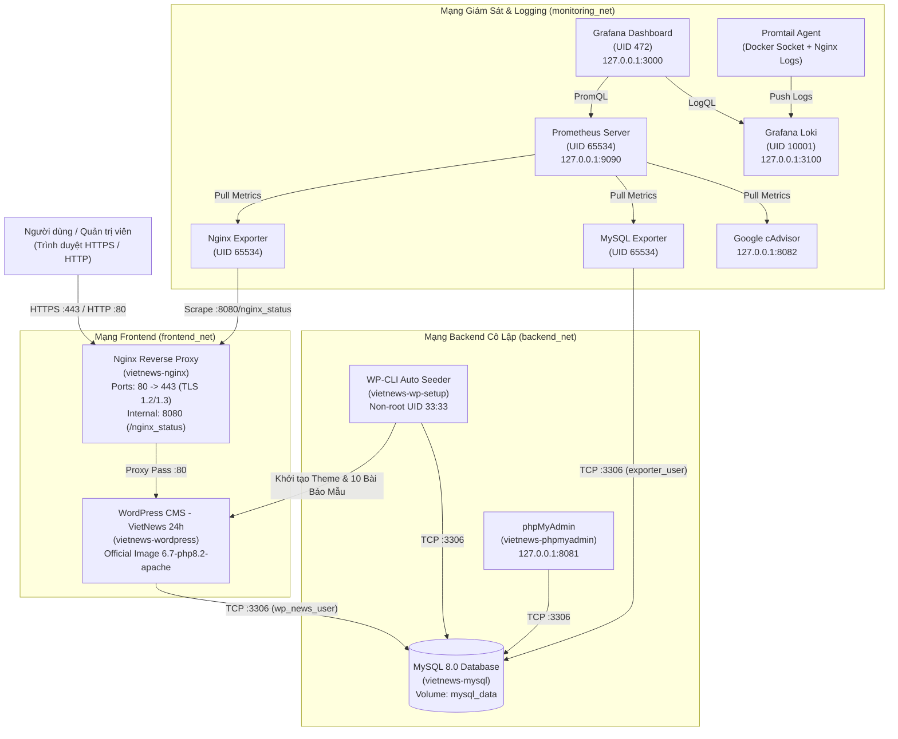

# ĐỀ TÀI 19: TRIỂN KHAI VÀ QUẢN TRỊ HỆ THỐNG WEBSITE TIN TỨC / CỔNG THÔNG TIN (VIETNEWS 24H)

> **Trường:** Trường Đại học Công Nghệ Thông Tin và Truyền Thông — Khoa Công Nghệ Thông Tin  
> **Sinh viên thực hiện:** Đào Tùng Anh — **MSSV:** `DTC245220035` — **Lớp:** An Toàn Thông Tin  
> **Repository GitHub:** [https://github.com/dtc245220035-hue/De-tai-19](https://github.com/dtc245220035-hue/De-tai-19)  
> **Học phần:** Triển khai và Quản trị Hệ thống Phần mềm  
> **Đề tài thực hành:** Đề 19 — Website Tin tức / Cổng thông tin (Bài viết, Danh mục, Admin đăng bài)  
> **Công nghệ triển khai:** Docker Compose, WordPress (Official Image + Giao diện Cổng thông tin Tiếng Việt `vietnews-portal`), MySQL 8.0, phpMyAdmin, Nginx Reverse Proxy (HTTPS tự ký + Security Headers), Prometheus, Grafana, cAdvisor, Nginx Exporter, MySQL Exporter, Loki & Promtail (LogQL).

---

## 1. Kiến trúc tổng thể hệ thống

Hệ thống được thiết kế theo kiến trúc đa tầng đóng gói bằng **Docker Compose** và tách biệt thành **3 phân vùng mạng nội bộ độc lập (`frontend_net`, `backend_net`, `monitoring_net`)** nhằm đảm bảo an toàn thông tin (Network Isolation):



---

## 2. Cấu trúc thư mục dự án

```text
.
├── .env                                    # File cấu hình biến môi trường và mật khẩu mạnh
├── .env.example                            # File mẫu biến môi trường
├── .gitattributes                          # Chuẩn hóa ký tự xuống dòng LF cho Linux containers
├── .gitignore                              # Danh sách file loại trừ khỏi Git
├── docker-compose.yml                      # Định nghĩa toàn bộ 12 dịch vụ, 3 mạng và 6 volumes
├── README.md                               # Hướng dẫn cài đặt, vận hành và kịch bản demo
├── BAO_CAO_DO_AN_DE_19.md                  # Báo cáo đồ án chi tiết (>= 10 trang nội dung)
├── mysql/
│   ├── conf.d/hardening.cnf                # Cấu hình gia cố bảo mật & UTF8mb4 cho MySQL 8.0
│   ├── init/01-init-security.sql           # Script phân quyền tối thiểu (Least Privilege)
│   └── exporter.cnf                        # Thông tin kết nối chỉ đọc cho mysqld-exporter
├── nginx/
│   ├── nginx.conf                          # Cấu hình lõi Nginx (server_tokens off, rate limit, gzip)
│   ├── conf.d/default.conf                 # Reverse proxy HTTPS, Security Headers, chặn file nhạy cảm
│   └── certs/                              # Chứng chỉ số SSL tự ký (server.crt, server.key)
├── wordpress/
│   ├── setup/init-wordpress.sh             # Script WP-CLI tự động cài đặt & tạo 10 bài báo mẫu
│   └── themes/vietnews-portal/             # Giao diện Cổng thông tin VietNews 24h tiếng Việt
│       ├── style.css                       # Giao diện chuẩn báo điện tử hiện đại, responsive
│       ├── functions.php                   # Xử lý lượt xem, thời gian đọc, ảnh SVG động, hardening
│       ├── header.php                      # Thanh tin nóng 24h, Logo, Tìm kiếm, Menu chuyên mục
│       ├── index.php                       # Trang chủ: Khu vực Tin Nổi Bật (Hero) + Tin Mới Nhất
│       ├── single.php                      # Trang đọc bài viết chi tiết + Bài cùng chuyên mục
│       ├── category.php                    # Trang danh sách bài viết theo chuyên mục
│       ├── search.php                      # Trang kết quả tìm kiếm bài viết
│       ├── sidebar.php                     # Thanh bên: Tìm kiếm, Danh mục, Tin đọc nhiều, Hạ tầng
│       └── footer.php                      # Chân trang cổng thông tin & liên kết nhanh
├── prometheus/
│   └── prometheus.yml                      # Cấu hình thu thập metrics từ 4 jobs
├── grafana/
│   └── provisioning/
│       ├── datasources/datasources.yml     # Tự động kết nối Prometheus & Loki
│       └── dashboards/
│           ├── dashboards.yml              # Tự động nạp Dashboard khi khởi động
│           └── json/vietnews-monitoring.json # Dashboard giám sát toàn diện Đề 19
├── loki/
│   ├── loki-config.yml                     # Cấu hình máy chủ lưu trữ log tập trung Loki
│   └── logql-queries.md                    # 6 câu truy vấn LogQL thực tế dùng khi demo
└── promtail/
    └── promtail-config.yml                 # Cấu hình thu thập log từ Docker Socket & Nginx
```

---

## 3. Hướng dẫn triển khai nhanh (Quick Start)

### Bước 1: Kiểm tra cấu hình và khởi chạy hệ thống
Mở Terminal / PowerShell tại thư mục gốc của dự án và chạy:

```bash
# Kiểm tra tính hợp lệ của file docker-compose.yml
docker compose config -q

# Khởi chạy toàn bộ 12 dịch vụ ở chế độ nền
docker compose up -d
```

> **Lưu ý:** Ngay sau khi `mysql` và `wordpress` khởi động xong, container `vietnews-wp-setup` sẽ tự động cài đặt WordPress, kích hoạt giao diện **VietNews 24h Portal**, tạo **6 chuyên mục tin tức** và đăng sẵn **10 bài báo tiếng Việt mẫu** (trong đó có **4 bài viết nổi bật** ở đầu trang chủ). Quá trình này hoàn tất tự động sau khoảng 25–40 giây.

### Bước 2: Kiểm tra trạng thái các container
```bash
docker compose ps
```

---

## 4. Danh sách Địa chỉ Truy cập & Tài khoản Quản trị

> **Mẹo Demo:** Toàn bộ hệ thống đã được đồng bộ chuẩn hóa tên đăng nhập là **`admin`** và mật khẩu là **`Admin@123`** để thao tác nhanh chóng và thuận tiện nhất khi báo cáo.

| Dịch vụ | Địa chỉ truy cập (URL) | Tài khoản (Username) | Mật khẩu (Password) | Ghi chú |
| :--- | :--- | :--- | :--- | :--- |
| **Website Tin tức (HTTPS)** | `https://localhost` | *(Công khai)* | *(Công khai)* | Chấp nhận chứng chỉ tự ký trên trình duyệt |
| **Website Tin tức (HTTP)** | `http://localhost` | *(Công khai)* | *(Công khai)* | Tự động Redirect `301` sang `https://localhost` |
| **Quản trị WordPress (Admin)** | `https://localhost/wp-admin/` | `admin` *(hoặc `admin_vietnews`)* | `Admin@123` | Toàn quyền đăng/sửa/xóa bài, quản lý danh mục |
| **Biên tập viên WordPress** | `https://localhost/wp-admin/` | `bientapvien` | `Admin@123` | Tài khoản vai trò Editor để demo phân quyền |
| **phpMyAdmin (Quản trị DB)** | `http://127.0.0.1:8081` | `admin` *(hoặc `root`, `wp_news_user`)* | `Admin@123` | Máy chủ: `mysql` |
| **Grafana Dashboard** | `http://127.0.0.1:3000` | `admin` | `Admin@123` | Có sẵn Dashboard **Đề 19: Giám Sát Hệ Thống...** |
| **Prometheus UI** | `http://127.0.0.1:9090` | *(Nội bộ loopback)* | *(Không)* | Kiểm tra `Status -> Targets` (4/4 UP) |
| **Loki Ready API** | `http://127.0.0.1:3100/ready` | *(Nội bộ loopback)* | *(Không)* | Truy vấn LogQL qua Grafana Explore |
| **cAdvisor UI** | `http://127.0.0.1:8082` | *(Nội bộ loopback)* | *(Không)* | Giám sát tài nguyên Container trực tiếp |

---

## 5. Kịch bản Demo Bảo vệ Đồ án (Theo 7 Tiêu chí Chấm điểm)

### 5.1. Demo Website Tin tức & Quản trị WordPress
1. Truy cập `https://localhost`:
   - Quan sát khu vực **Bài viết nổi bật & Tiêu điểm** (1 bài lớn + 3 bài tiêu điểm phụ) và khu vực **Bài viết mới nhất**.
   - Nhấn vào các chuyên mục trên thanh menu (**Thời sự**, **Công nghệ & AI**, **Kinh tế - Tài chính**, **An ninh mạng & Hệ thống**, **Giáo dục**, **Đời sống**).
   - Nhấn vào một bài viết bất kỳ để xem trang đọc bài chi tiết (hiển thị breadcrumb, thời gian đọc, lượt xem, bài viết cùng chuyên mục).
   - Nhập từ khóa `Docker` hoặc `AI` vào ô **Tìm kiếm** trên đầu trang để kiểm tra chức năng tìm kiếm.
2. Truy cập `https://localhost/wp-admin/` (đăng nhập với `admin` / `Admin@123`):
   - Vào **Bài viết (Posts) -> Viết bài mới (Add New)** để đăng bài mới hoặc sửa bài hiện có.
   - Vào **Bài viết -> Chuyên mục (Categories)** để thêm/sửa/xóa danh mục tin tức.

### 5.2. Demo Cơ sở dữ liệu & phpMyAdmin
- Mở `http://127.0.0.1:8081`, đăng nhập bằng Server: `mysql`, Tài khoản: `admin`, Mật khẩu: `Admin@123`.
- Mở cơ sở dữ liệu `vietnews_db`, kiểm tra các bảng có tiền tố `vn24_` (`vn24_posts`, `vn24_terms`, `vn24_users`...).

### 5.3. Demo Nginx Reverse Proxy, HTTPS & Security Headers
Chạy lệnh kiểm tra Header phản hồi từ Nginx:
```bash
curl -k -I https://localhost
```
Xác nhận có đầy đủ các Security Headers:
- `Strict-Transport-Security: max-age=31536000; includeSubDomains`
- `X-Frame-Options: SAMEORIGIN`
- `X-Content-Type-Options: nosniff`
- `X-XSS-Protection: 1; mode=block`
- `Referrer-Policy: strict-origin-when-cross-origin`
- `Permissions-Policy: geolocation=(), microphone=(), camera=(), payment=()`
- `Server: nginx` (đã ẩn phiên bản nhờ `server_tokens off;`)

Kiểm tra chặn file nhạy cảm (`403 Forbidden`):
```bash
curl -k -I https://localhost/xmlrpc.php
curl -k -I https://localhost/wp-config.php
```

### 5.4. Demo Giám sát Prometheus + Grafana
1. Mở `http://127.0.0.1:9090/targets`: Xác nhận cả 4 targets (`prometheus`, `nginx-exporter`, `mysql-exporter`, `cadvisor`) đều có trạng thái **UP**.
2. Mở `http://127.0.0.1:3000`, đăng nhập bằng `admin_monitor` / `VnNews#Grafana$2026!Mon44`.
3. Vào mục **Dashboards -> Đề 19 - VietNews 24h -> Đề 19: Giám Sát Hệ Thống Website Tin Tức VietNews 24h** để xem trực quan toàn bộ chỉ số Container, Nginx, MySQL và Logs.

### 5.5. Demo Truy vấn Log tập trung với Loki & LogQL
Tại Grafana (`http://127.0.0.1:3000`), vào **Explore** -> chọn nguồn dữ liệu **Loki** và chạy 4 câu truy vấn LogQL sau:

1. **Truy vấn 1 — Toàn bộ log truy cập và hoạt động của Nginx Reverse Proxy:**
   ```logql
   {service="nginx"}
   ```
2. **Truy vấn 2 — Lọc các truy cập vào trang quản trị hoặc đăng nhập WordPress:**
   ```logql
   {service="wordpress"} |~ "wp-(admin|login)"
   ```
3. **Truy vấn 3 — Phát hiện các truy cập bị chặn bảo mật hoặc lỗi HTTP (403, 404, 429, 5xx):**
   ```logql
   {service="nginx"} |~ "\" (403|404|429|500|502|503) "
   ```
4. **Truy vấn 4 — Thống kê tốc độ sinh log theo từng dịch vụ trong 5 phút qua:**
   ```logql
   sum by (service) (rate({job="docker-containers"}[5m]))
   ```

### 5.6. Tổng hợp các biện pháp Hardening đã áp dụng
1. **Chính sách mật khẩu mạnh:** Toàn bộ tài khoản MySQL, WordPress, Grafana đều sử dụng mật khẩu phức tạp >= 20 ký tự quản lý qua `.env`.
2. **Non-root Container:** Các dịch vụ `prometheus` (`65534`), `nginx-exporter` (`65534`), `mysql-exporter` (`65534`), `grafana` (`472`), `loki` (`10001`), `wp-setup` (`33`) chạy trực tiếp bằng UID non-root; tiến trình worker của `mysql` (`999`), `nginx` (`101`), `wordpress` (`33`) đều hạ quyền.
3. **Giới hạn quyền & Tài nguyên:** Áp dụng `security_opt: ["no-new-privileges:true"]`, `cap_drop: ["ALL"]` trên các dịch vụ giám sát/exporter và giới hạn `mem_limit`, `pids_limit` trên toàn bộ container.
4. **Cô lập mạng (Network Isolation):** Chia tách `frontend_net`, `backend_net` và `monitoring_net`. Container `nginx` không có kết nối trực tiếp tới `backend_net` của `mysql`.
5. **Ẩn cổng nội bộ & Loopback Binding:** Không mở cổng `3306` (MySQL), `80` (WordPress nội bộ), `9113` (Nginx Exporter), `9104` (MySQL Exporter) ra máy host; các công cụ quản trị chỉ bind vào `127.0.0.1`.
6. **Nguyên tắc Least Privilege trên Database:** Tách riêng user `wp_news_user` (chỉ có quyền trên `vietnews_db`) và `exporter_user` (chỉ đọc metrics với tối đa 5 kết nối), tắt `local_infile` và `symbolic-links`.
